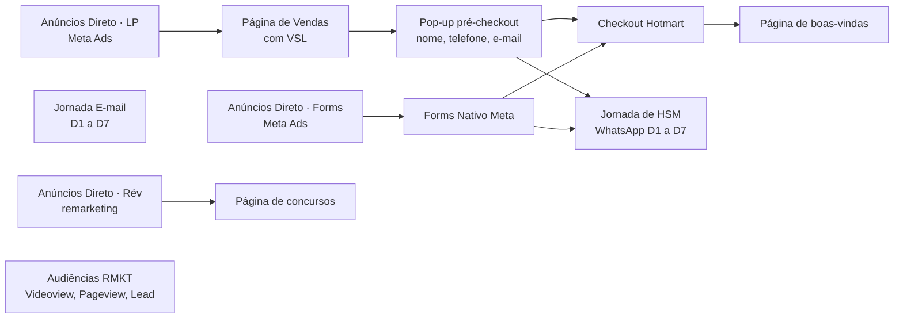

# Funil VSL · Plataforma

Funil de vendas da Revolução Concursos: anúncios levam para a página com a VSL, um
pop-up coleta o contato, o checkout fica na Hotmart e quem não compra recebe 7 dias
de mensagens no WhatsApp e no e-mail ao mesmo tempo (o "Ataque Soviético").

## Etapas

| Etapa | O que acontece |
| --- | --- |
| Anúncios Direto · LP | Campanhas na Meta para a página, otimizadas para lead e para compra |
| Página de Vendas | [revolucao.com.br/k/pagina-de-vendas](https://revolucao.com.br/k/pagina-de-vendas/): VSL com preço, texto da página sem preço, botão para ver a oferta |
| Pop-up pré-checkout | Pede nome, telefone e e-mail antes de abrir o checkout |
| Checkout Hotmart | Vídeo de reforço da oferta no topo e campos já preenchidos com os dados do pop-up |
| Página de boas-vindas | [revolucao.com.br/k/pagina-inicial](https://revolucao.com.br/k/pagina-inicial/) |
| Anúncios Direto · Forms | Campanhas na Meta com formulário nativo (nome, telefone, e-mail) |
| Jornada de HSM | 7 mensagens de WhatsApp, uma por dia: [mensagens/whatsapp.md](mensagens/whatsapp.md) |
| Jornada E-mail | 7 e-mails, um por dia, em paralelo: [mensagens/emails.md](mensagens/emails.md) |
| Audiências RMKT | Públicos de quem viu o vídeo, visitou a página ou virou lead |
| Anúncios Direto · Rév | Remarketing para esses públicos, levando à [página de concursos](https://revolucao.com.br/k/pagina-de-concursos/) |

## Arquivos

| Arquivo | O que é |
| --- | --- |
| `funil.json` | O desenho completo, no formato do painel Funil ao Vivo (27 etapas, 23 ligações) |
| `mensagens/whatsapp.md` | Exemplos das mensagens D1 a D7 do WhatsApp |
| `mensagens/emails.md` | Exemplos dos e-mails D1 a D7 |

As mensagens são exemplos, não a versão final. Os números de entradas e avanços no
`funil.json` vêm da simulação do painel, não são dados reais.
